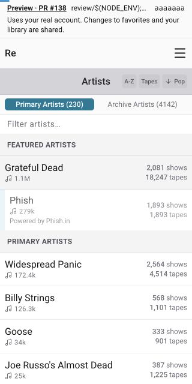

# Preview runtime verification

The same built `linux/amd64` image was started with and without preview metadata on November 14, 2026. Both containers ran as UID/GID 1001 with a read-only root, no capabilities, and writable `/tmp`. The preview indicator is a runtime choice; the image does not need rebuilding for another PR.

The local fixture used PR 138, commit `aaaaaaaaaaaaaaaaaaaaaaaaaaaaaaaaaaaaaaaa`, and literal branch text `review/$(NODE_ENV);<b>$(id)</b>`. These are rendering fixtures, not an active PR deployment. Chrome showed that text literally, without creating a `<b>` element. The indicator survived hydrated navigation to `/phish`. The ordinary container had no indicator. Neither response included an unrelated environment sentinel injected for the test.

The 320px layout kept the metadata visible with no horizontal overflow. About fitted a 1280×720 viewport; the embed fitted a 375×400 viewport, including its indicator. Preview privacy-policy responses returned `X-Robots-Tag: noindex, nofollow, noarchive`.

The unit suite passed 39 tests, typecheck and production build passed, and focused lint passed on changed files. Full-repository lint still reports existing unescaped-apostrophe errors in About and Open Graph files. This local container proof does not establish live Tailscale login or CI deployment; those are separate activation checks.
